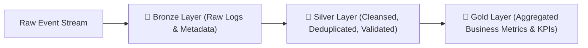

# 🌊 Spark Data Lake Pipeline (Medallion Architecture)

[](https://github.com/MSBHOSLE/spark-data-lake-pipeline/actions)
[](https://spark.apache.org/)
[](https://delta.io/)
[](https://python.org)
[](LICENSE)

An enterprise-grade **PySpark ETL Lakehouse Pipeline** implementing the **Bronze / Silver / Gold Medallion Architecture** backed by **Delta Lake**. Features automated schema enforcement, deduplication, incremental transformations, and business KPI aggregations.

---

## 🏗️ Medallion Architecture Overview



---

## ⚡ Highlights

- **Bronze Layer**: Append-only raw event ingestion preserving original payload fidelity.
- **Silver Layer**: Data cleansing, schema conformity, deduplication, and anomaly rejection.
- **Gold Layer**: Aggregated star-schema / dimensional metrics computed for business intelligence and analytics.

---

## 🚀 Running Tests

```bash
python -m unittest discover tests
```

---

## 👤 Author

**Mahesh Sanjayrao Bhosle**
- **GitHub:** [@MSBHOSLE](https://github.com/MSBHOSLE)
- **LinkedIn:** [Mahesh Bhosle](https://linkedin.com/in/mahesh-bhosle-916991198)
- **Email:** msbhosle.2@gmail.com
- **Education:** M.Sc. Data & Computer Science, Heidelberg University

---

## 📄 License

MIT License - see [LICENSE](LICENSE).
